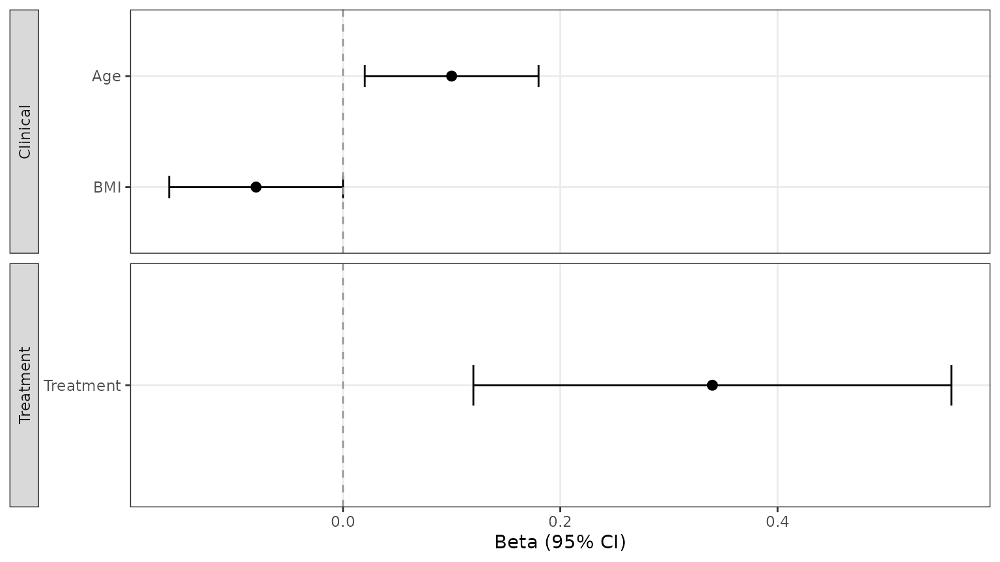
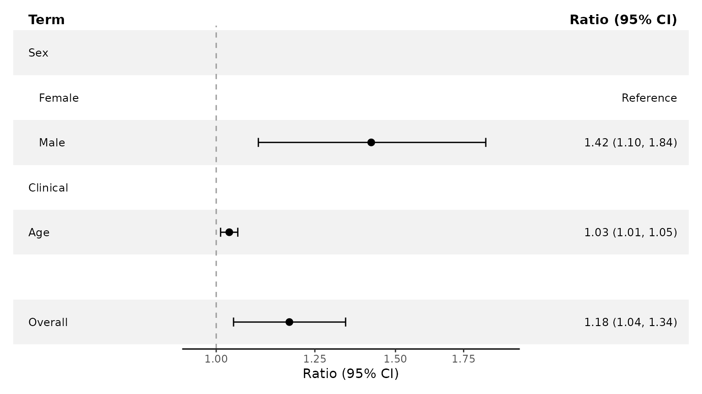
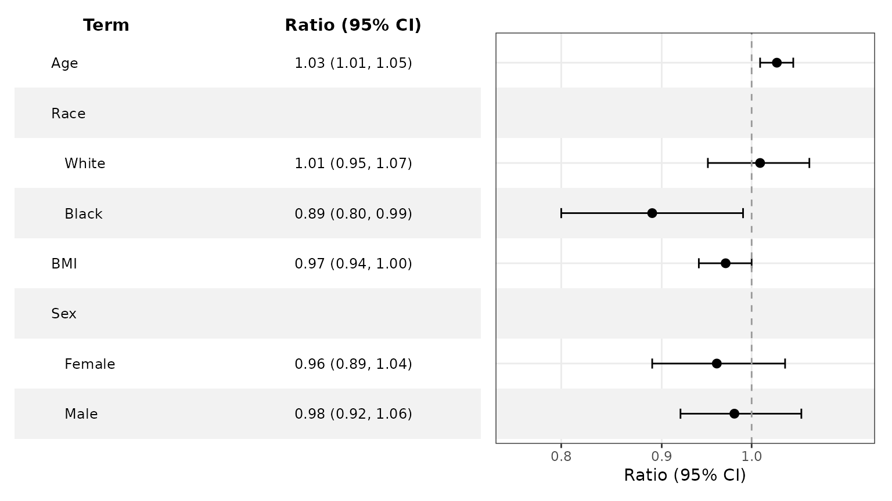

# Preparing Forest Data

``` r

library(ggforestplotR)
library(ggplot2)
```

Use this guide for custom column mappings, metadata, and structured
rows. For model extraction and subgroup inference, see [Working with
Fitted
Models](https://thatoneguy006.github.io/ggforestplotR/dev/articles/ggforestplotR-fitted-models.md).

## Use `as_forest_data()` to standardize a coefficient table

[`as_forest_data()`](https://thatoneguy006.github.io/ggforestplotR/dev/reference/as_forest_data.md)
converts your column names into the internal structure used by
`ggforestplotR`. The result is a `forest_data` data-frame subclass
containing the columns expected by
[`ggforestplot()`](https://thatoneguy006.github.io/ggforestplotR/dev/reference/ggforestplot.md),
[`add_forest_table()`](https://thatoneguy006.github.io/ggforestplotR/dev/reference/add_forest_table.md),
and
[`add_split_table()`](https://thatoneguy006.github.io/ggforestplotR/dev/reference/add_split_table.md).

``` r

raw_coefs <- data.frame(
  variable = c("Age", "BMI", "Treatment"),
  beta = c(0.10, -0.08, 0.34),
  lower = c(0.02, -0.16, 0.12),
  upper = c(0.18, 0.00, 0.56),
  display = c("Age", "BMI", "Treatment"),
  section = c("Clinical", "Clinical", "Treatment"),
  sample_size = c(120, 115, 98),
  p_value = c(0.04, 0.15, 0.001)
)

forest_ready <- as_forest_data(
  data = raw_coefs,
  term = "variable",
  estimate = "beta",
  conf.low = "lower",
  conf.high = "upper",
  label = "display",
  facet = "section",
  n = "sample_size",
  p.value = "p_value",
  estimate_scale = "identity",
  effect_label = "Beta",
  conf.level = 0.95
)
```

Use
[`forest_metadata()`](https://thatoneguy006.github.io/ggforestplotR/dev/reference/forest_metadata.md)
to inspect the attributed metadata. The complete fitted model and a
duplicate copy of the source data are not retained.

``` r

forest_metadata(forest_ready)[c(
  "estimate_scale", "axis_transform", "effect_label", "conf_level",
  "reference_value", "source_model", "source_package", "source_columns"
)]
#> $estimate_scale
#> [1] "identity"
#> 
#> $axis_transform
#> [1] "identity"
#> 
#> $effect_label
#> [1] "Beta"
#> 
#> $conf_level
#> [1] 0.95
#> 
#> $reference_value
#> [1] 0
#> 
#> $source_model
#> NULL
#> 
#> $source_package
#> NULL
#> 
#> $source_columns
#>      variable          beta         lower         upper       display 
#>    "variable"        "beta"       "lower"       "upper"     "display" 
#>       section   sample_size       p_value 
#>     "section" "sample_size"     "p_value"
```

Once the data are standardized, you can pass them straight into
[`ggforestplot()`](https://thatoneguy006.github.io/ggforestplotR/dev/reference/ggforestplot.md).

``` r

ggforestplot(forest_ready)
```



## Structured forest data and reference rows

Map a source column with `row_type =` to place reference categories and
structural rows alongside estimates. `estimate` and `summary` rows need
finite estimates and confidence bounds. `reference`, `header`, and
`spacer` rows use `NA` for all three geometry values. Structured rows
keep their source order; `sort_terms` must remain `"none"`.

``` r

structured <- data.frame(
  term = c("Female", "Male", "Clinical", "Age", "", "Overall"),
  estimate = c(NA, 1.42, NA, 1.03, NA, 1.18),
  conf.low = c(NA, 1.10, NA, 1.01, NA, 1.04),
  conf.high = c(NA, 1.84, NA, 1.05, NA, 1.34),
  subgroup = c("Sex", "Sex", NA, NA, NA, NA),
  row_type = c("reference", "estimate", "header", "estimate", "spacer",
               "summary")
)

ggforestplot(
  structured,
  subgroup = "subgroup",
  row_type = "row_type",
  exponentiate = TRUE,
  striped_rows = TRUE
) +
add_split_table(
  left_columns = "term",
  right_columns = c("estimate"),
  reference_text = "Reference"
)
```



You can also supply explicit `"header"` and `"spacer"` rows in the
source table. A mapped `subgroup` creates its own header; reference rows
inside the subgroup appear as indented children.

## Supply subgroup rows explicitly

For an existing coefficient table, set
`subgroup = "subgroup_variable_name"`. This functionality still works
when some variables have subgroups and others don’t, demonstrated here.

``` r

mixed_coefs <- tibble::tribble(
  ~term,    ~subgroup, ~estimate, ~conf.low, ~conf.high,
  "Age",    NA_character_, 1.03,      1.01,       1.05,
  "White",  "Race",        1.01,      0.95,       1.07,
  "Black",  "Race",        0.89,      0.80,       0.99,
  "BMI",    NA_character_, 0.97,      0.94,       1.00,
  "Female", "Sex",         0.96,      0.89,       1.04,
  "Male",   "Sex",         0.98,      0.92,       1.06
)

ggforestplot(
  mixed_coefs,
  term = "term",
  subgroup = "subgroup",
  estimate = "estimate",
  conf.low = "conf.low",
  conf.high = "conf.high",
  exponentiate = TRUE,
  striped_rows = TRUE
) +
  add_forest_table()
```



This subgroup mapping controls presentation; it does not compute effects
or tests. Keep each subgroup in one contiguous block. With
`p_method = "overall"`, the first nonmissing p-value in a block appears
on its header; use `p_method = "level"` for values on individual rows.

Custom source columns remain available for table selection and
formatting. See [Customize Forest Plots and
Tables](https://thatoneguy006.github.io/ggforestplotR/dev/articles/ggforestplotR-plot-customization.md)
for display controls.
