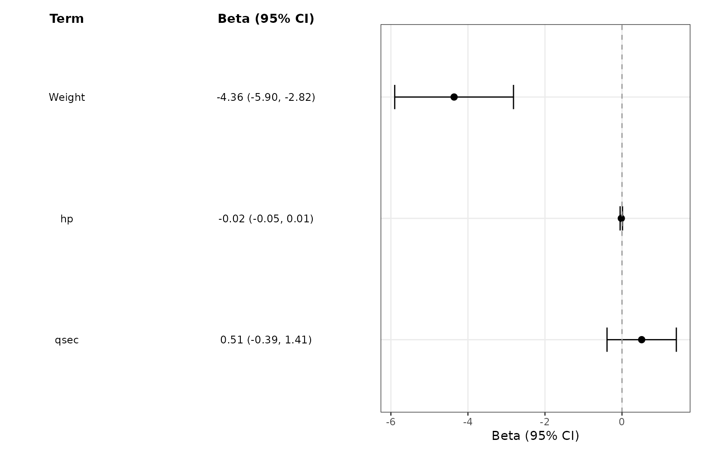
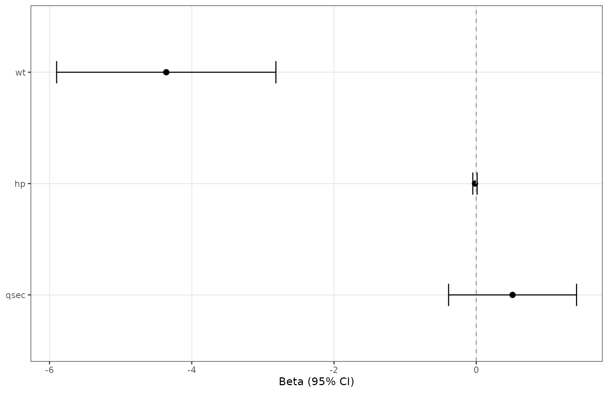
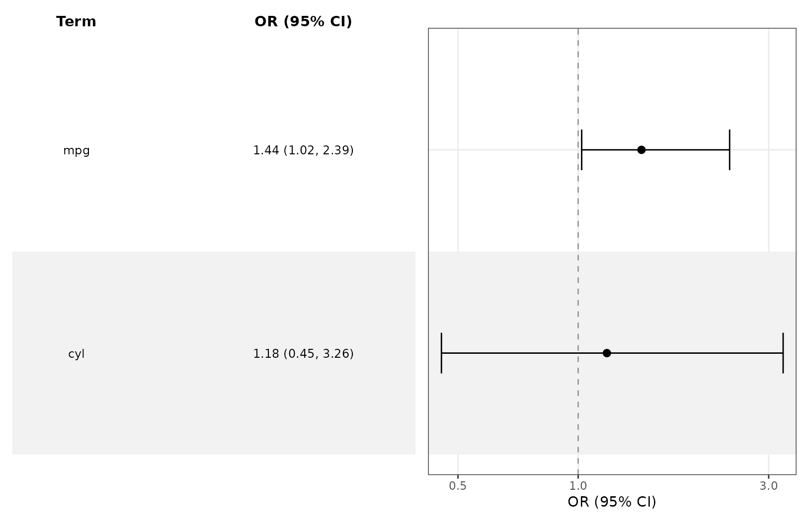
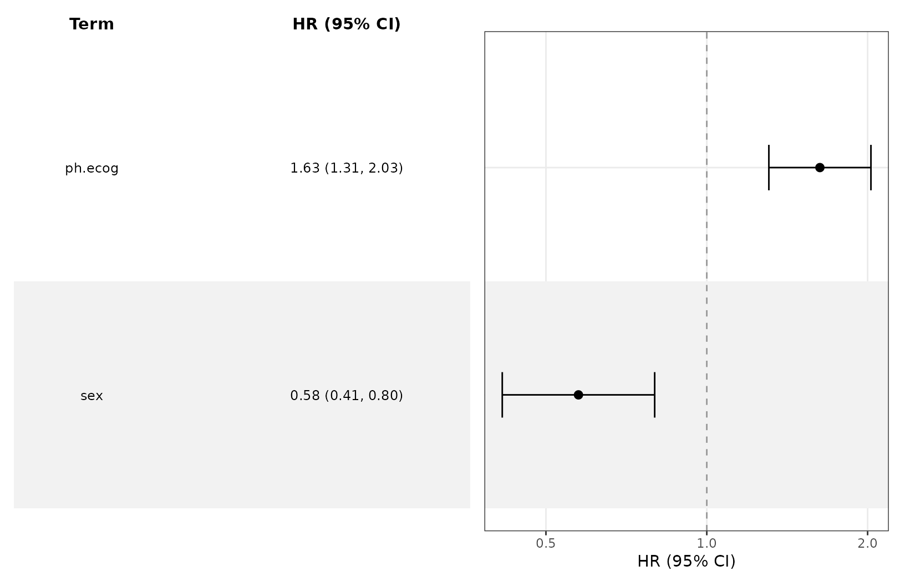
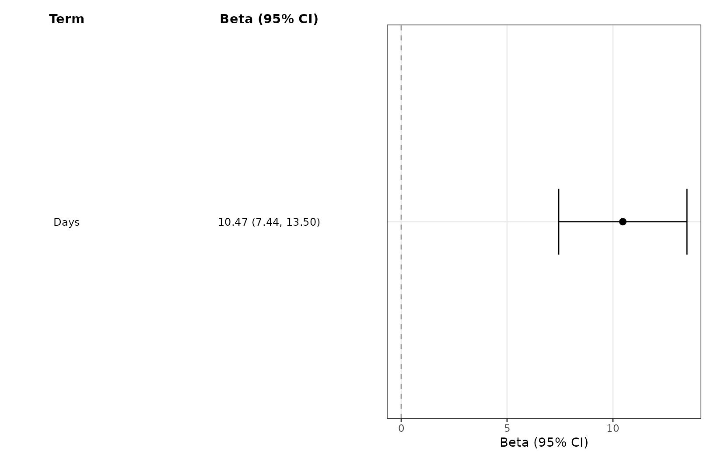
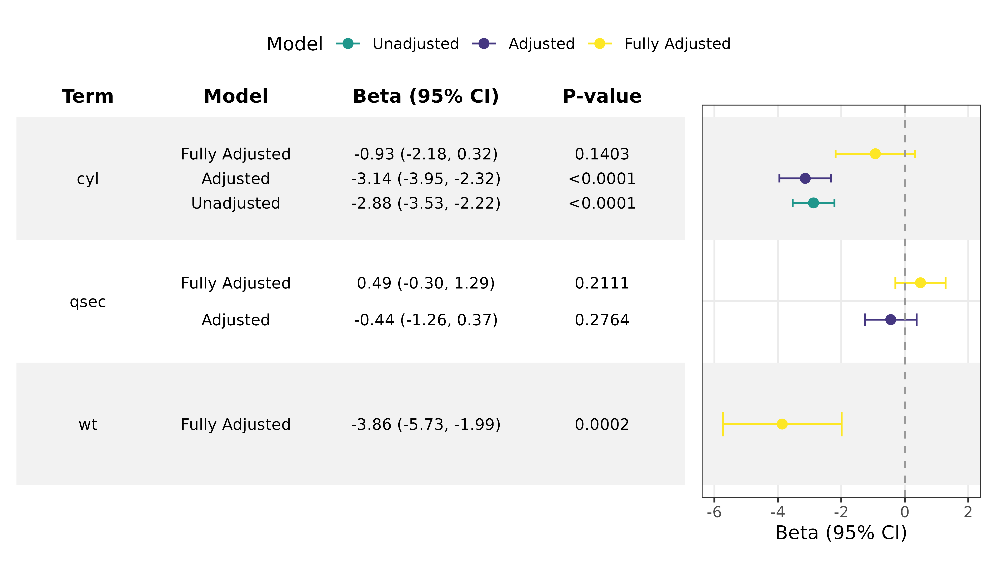
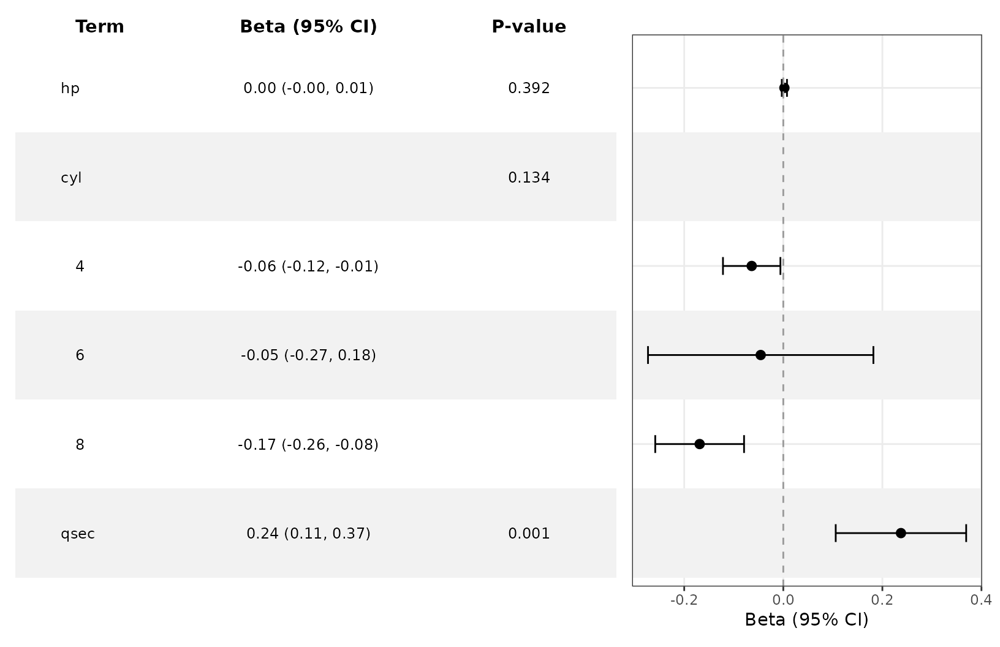
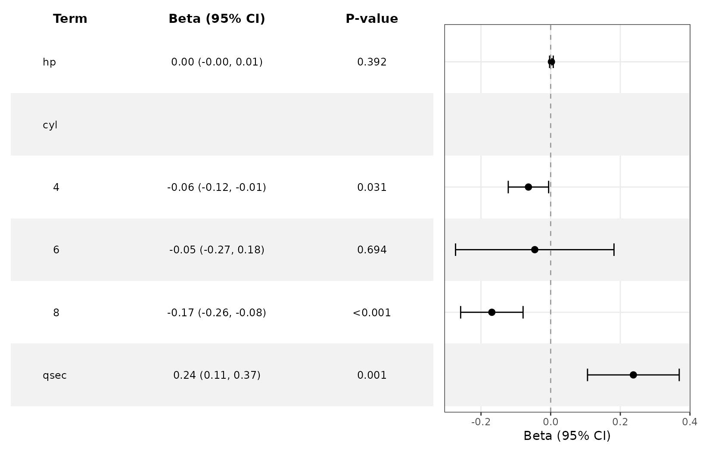
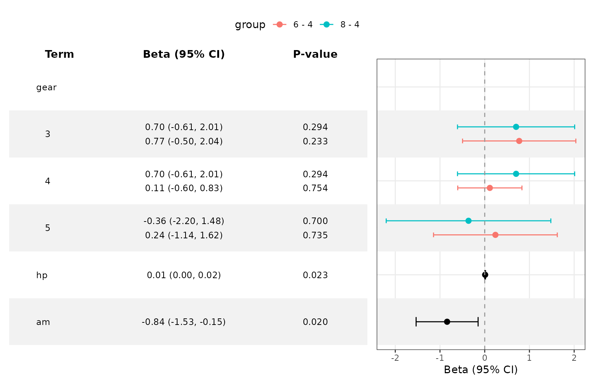

# Working with Fitted Models

``` r

library(ggforestplotR)
library(ggplot2)
```

This guide covers fitted-model inputs, effect scales, model comparisons,
and derived subgroup effects. For appearance and layout, see [Customize
Forest Plots and
Tables](https://thatoneguy006.github.io/ggforestplotR/dev/articles/ggforestplotR-plot-customization.md).

## Supported fitted models

Explicit conversion methods are available for the following classes.
Their tidiers must supply estimates and confidence limits.

| Model input | Required extraction packages | Output and scope |
|:---|:---|:---|
| [`stats::lm()`](https://rdrr.io/r/stats/lm.html) (`lm`) | `broom` | Additive coefficients (Beta). |
| [`stats::glm()`](https://rdrr.io/r/stats/glm.html) (`glm`) | `broom` | Scale follows family and link, as described below. |
| [`survival::coxph()`](https://rdrr.io/pkg/survival/man/coxph.html) (`coxph`) | `broom`, `survival` | Hazard ratios (HR). |
| `lme4` models (`merMod`) | `broom`, `broom.mixed`, `lme4` | Fixed effects; scale follows family and link. |
| [`nlme::lme()`](https://rdrr.io/pkg/nlme/man/lme.html) (`lme`) | `broom`, `broom.mixed`, `nlme` | Fixed-effect additive coefficients. |
| [`glmmTMB::glmmTMB()`](https://rdrr.io/pkg/glmmTMB/man/glmmTMB.html) (`glmmTMB`) | `broom`, `broom.mixed`, `glmmTMB` | Conditional-model fixed effects; excludes zero-inflation and dispersion coefficients. |

Coefficient extraction and derived subgroup effects have different
requirements. Subgroup inference additionally uses `marginaleffects` and
has the restrictions described below. A `broom` tidier alone does not
imply direct support for every model class. For other inputs, use a
coefficient table as described in [Preparing Forest
Data](https://thatoneguy006.github.io/ggforestplotR/dev/articles/ggforestplotR-data-helpers.md).

## Plot a fitted model

``` r

fit <- lm(mpg ~ wt + hp + qsec, data = mtcars)
ggforestplot(fit, term_labels = c("wt" = "Weight")) +
  add_forest_table()
```



## Inspect coefficients before plotting

If `broom` is available, the model-specific
[`as_forest_data()`](https://thatoneguy006.github.io/ggforestplotR/dev/reference/as_forest_data.md)
method pulls coefficient estimates and confidence limits from a fitted
model. The method also assigns model semantics such as `Beta`, `OR`, or
`HR`.

``` r

fit <- lm(mpg ~ wt + hp + qsec, data = mtcars)

model_ready <- as_forest_data(fit)
```

The returned object can be passed directly into
[`ggforestplot()`](https://thatoneguy006.github.io/ggforestplotR/dev/reference/ggforestplot.md).

``` r

ggforestplot(model_ready)
```



[`tidy_forest_model()`](https://thatoneguy006.github.io/ggforestplotR/dev/reference/tidy_forest_model.md)
remains available as a compatibility wrapper and returns the same
`forest_data` object.

## Effect scales and confidence intervals

With `exponentiate = NULL`, binomial and quasibinomial logit models use
odds ratios, Cox models use hazard ratios, and log-link Poisson models
use incidence rate ratios. Binomial log-link models use risk ratios;
identity-link binomial models use risk differences. Other log-link
families use a ratio label. Linear models retain additive coefficients.

For fitted models, `exponentiate = FALSE` retains unexponentiated
coefficients; `TRUE` transforms coefficients and bounds. For data
frames, `TRUE` instead declares values that are **already ratios** and
does not transform them. Ratio plots default to a log10 axis with
reference value 1.

Use `as_forest_data(fit, conf.level = 0.90)` to request a different
confidence level. Confidence intervals are required. Intercepts are
omitted by default; use `as_forest_data(fit, intercept = TRUE)` to
retain them.

### Logistic regression

``` r

logit_fit <- glm(am ~ mpg + cyl, data = mtcars, family = binomial())
ggforestplot(logit_fit, striped_rows = TRUE) + add_forest_table()
```



### Survival analysis

``` r

cox_fit <- survival::coxph(
  survival::Surv(time, status == 2) ~ ph.ecog + sex,
  data = survival::lung
)
ggforestplot(cox_fit, striped_rows = TRUE) + add_forest_table()
```



### Mixed models

``` r

mixed_fit <- lme4::lmer(
  Reaction ~ Days + (Days | Subject), data = lme4::sleepstudy
)
ggforestplot(mixed_fit) +
  add_forest_table()
```



Mixed-model plots show fixed effects, not random-effect variances or
individual cluster effects. P-values are shown only when supplied by the
tidier.

## Compare fitted models

[`bind_forest_models()`](https://thatoneguy006.github.io/ggforestplotR/dev/reference/bind_forest_models.md)
checks compatible effect scales, axis transformations, reference values,
and confidence levels. Labels follow the supplied model order. Also
check that outcomes, predictor units, and populations make the
comparison meaningful.

``` r

fit1 <- lm(mpg ~ cyl, data = mtcars)
fit2 <- lm(mpg ~ cyl + qsec, data = mtcars)
fit3 <- lm(mpg ~ cyl + qsec + wt, data = mtcars)

bound_models <- bind_forest_models(
  list(fit1, fit2, fit3),
  model_labels = c("Unadjusted", "Adjusted", "Fully Adjusted")
)

ggforestplot(bound_models, striped_rows = TRUE, p.value = "p.value") +
  scale_x_continuous(limits = c(-6, 2)) +
  theme(legend.position = "top") +
  scale_color_manual(values = c("#1F968BFF", "#453781FF", "#FDE725FF")) +
  add_forest_table(
    columns = c("term", "model", "estimate", "p.value"),
    p_digits = 4
  )
#> Scale for colour is already present.
#> Adding another scale for colour, which will replace the existing scale.
```



## Derive subgroup effects from an interaction model

For a fitted model with one continuous-by-factor interaction,
`subgroup = "auto"` identifies the factor from model metadata and
estimates the focal variable’s average slope within each observed factor
level.

``` r

interaction_fit <- lm(wt ~ hp + mpg * factor(cyl) + qsec, data = mtcars)

subgroup_ready <- tidy_forest_model(
  interaction_fit,
  subgroup = "auto",
  focal = "mpg"
)

as.data.frame(subgroup_ready)[, c(
  "term", "subgroup", "estimate", "conf.low", "conf.high", "p.value"
)]
#>   term subgroup     estimate     conf.low    conf.high     p.value
#> 1   hp     <NA>  0.002211858 -0.003019553  0.007443269 0.391515516
#> 2    4      cyl -0.063790596 -0.121760403 -0.005820789 0.133731900
#> 3    6      cyl -0.045622115 -0.273096846  0.181852616 0.133731900
#> 4    8      cyl -0.168851554 -0.258484920 -0.079218188 0.133731900
#> 5 qsec     <NA>  0.237491332  0.105815640  0.369167024 0.001059097

ggforestplot(subgroup_ready, striped_rows = TRUE) +
  add_forest_table(columns = c("term", "estimate", "p"))
```



These rows are average `mpg` slopes within the `cyl` levels. They come
from
[`marginaleffects::avg_slopes()`](https://rdrr.io/pkg/marginaleffects/man/slopes.html)
using the original model and its covariance matrix. No subgroup-specific
models are refitted. The focal main effect, factor main-effect
coefficients, and raw interaction coefficients are replaced by the
derived block; unrelated coefficients remain standalone in formula
order.

The same interaction can be selected explicitly:

``` r

tidy_forest_model(
  interaction_fit,
  subgroup = "cyl",
  focal = "mpg"
)
#> <forest_data> Beta; scale: identity; reference: 0
#>   term     estimate     conf.low    conf.high label row_type group subgroup
#> 1   hp  0.002211858 -0.003019553  0.007443269    hp estimate  <NA>     <NA>
#> 2    4 -0.063790596 -0.121760403 -0.005820789     4 estimate  <NA>      cyl
#> 3    6 -0.045622115 -0.273096846  0.181852616     6 estimate  <NA>      cyl
#> 4    8 -0.168851554 -0.258484920 -0.079218188     8 estimate  <NA>      cyl
#> 5 qsec  0.237491332  0.105815640  0.369167024  qsec estimate  <NA>     <NA>
#>   grouping separate_groups    n events     p.value   std.error  statistic df
#> 1     <NA>            <NA> <NA>   <NA> 0.391515516 0.002534723  0.8726232 NA
#> 2     <NA>            <NA> <NA>   <NA> 0.133731900 0.029576976 -2.1567653 NA
#> 3     <NA>            <NA> <NA>   <NA> 0.133731900 0.116060669 -0.3930885 NA
#> 4     <NA>            <NA> <NA>   <NA> 0.133731900 0.045732150 -3.6921849 NA
#> 5     <NA>            <NA> <NA>   <NA> 0.001059097 0.063799498  3.7224640 NA
#>   subgroup_level focal      model_term contrast      estimand effect_scale
#> 1           <NA>  <NA>            <NA>     <NA>          <NA>         <NA>
#> 2              4   mpg mpg:factor(cyl)    dY/dX average_slope     identity
#> 3              6   mpg mpg:factor(cyl)    dY/dX average_slope     identity
#> 4              8   mpg mpg:factor(cyl)    dY/dX average_slope     identity
#> 5           <NA>  <NA>            <NA>     <NA>          <NA>         <NA>
```

Automatic selection currently requires exactly one unambiguous
continuous-by-factor interaction. Factor-by-factor effects require
explicit predictor names and use
[`marginaleffects::avg_comparisons()`](https://rdrr.io/pkg/marginaleffects/man/comparisons.html).
Continuous subgroups, transformed focal terms, multiple selected
interactions, and three-way interactions are rejected. Logistic and Cox
effects are calculated on their model scale and shown as odds ratios and
hazard ratios by default, not as marginal probabilities or survival
probabilities.

The canonical `p.value` combines two compatible display roles: ordinary
covariates retain their coefficient p-values, while every derived
subgroup block receives an omnibus Wald test of the selected
interaction. The display layer moves that interaction p-value to the
subgroup header and leaves the individual levels blank, so one table
column can present both kinds of tests.

Use `p_method = "level"` when the subgroup-specific slope or comparison
tests are the quantities that should appear beside the individual
estimates:

``` r

level_p_ready <- tidy_forest_model(
  interaction_fit,
  subgroup = "auto",
  focal = "mpg",
  p_method = "level"
)

ggforestplot(level_p_ready, striped_rows = TRUE) +
  add_forest_table(columns = c("term", "estimate", "p"))
```



Both methods use the same canonical `p.value` column. `"overall"`
changes the test and places it on the subgroup header; `"level"` retains
the tests returned for the derived effects and places them on the
subgroup rows.

### Categorical-by-categorical

``` r

fit2 <- lm(wt ~ as.factor(gear)*as.factor(cyl) + hp + am, data = mtcars)

fit2 |>
  tidy_forest_model(subgroup = "gear", focal = "cyl", p_method = "level") |>
  ggforestplot(striped_rows = TRUE) +
  theme(legend.position = "top") +
  add_forest_table(columns = c("term", "estimate", "p.value"))
#> Warning: Some coefficients are `NA`, possibly because the model matrix is rank
#> deficient. In such cases, the quantities produced by `marginaleffects` may
#> depend on the order of factor levels. This warning appears once per session.
#> Warning: Model matrix is rank deficient. Some variance-covariance parameters are
#>   missing.
#> Warning: The `cyl` variable is treated as a categorical (factor) variable, but
#> the original data is of class numeric. It is safer and faster to convert such
#> variables to factor before fitting the model and calling a `marginaleffects`
#> function. This warning appears once per session.
```



For mixed models, derived effects are population-level (random effects
set to zero). Supported subgroup links are identity, logit, and log; Cox
effects use the linear-predictor scale.
