# Customize Forest Plots and Tables

``` r

library(ggforestplotR)
library(ggplot2)
```

This article covers plot appearance, table formatting, and figure
layout. For model extraction, see [Working with Fitted
Models](https://thatoneguy006.github.io/ggforestplotR/dev/articles/ggforestplotR-fitted-models.md).

## Group rows and control strip placement

`facet` creates section panels, and `facet_strip_position` controls
which side gets the strip labels.

``` r

coefs <- data.frame(
  term = c("Age", "BMI", "Smoking", "Stage II", "Stage III"),
  estimate = c(0.12, -0.10, 0.18, 0.30, 0.46),
  conf.low = c(0.03, -0.18, 0.04, 0.10, 0.18),
  conf.high = c(0.21, 0.02, 0.32, 0.50, 0.74),
  sample_size = c(120, 115, 98, 87, 83),
  p_value = c(0.04, 0.15, 0.29, 0.001, 0.075),
  section = c("Clinical", "Clinical", "Clinical", "Tumor", "Tumor")
)


ggforestplot(
  coefs,
  facet = "section",
  facet_strip_position = "right",
  striped_rows = TRUE
)
```

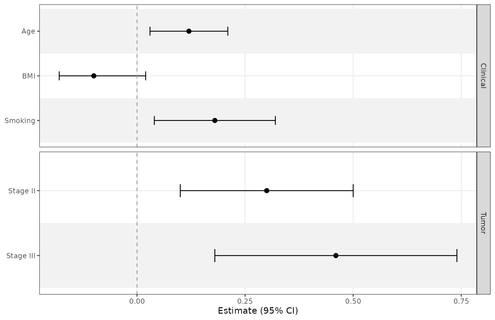

## Labels, ordering, and styling

Use `term_labels` to rename displayed terms and `sort_terms` to order
ordinary estimate rows. Subgroup and structured rows preserve source
order and require `sort_terms = "none"`.

``` r

ggforestplot(
  coefs,
  term_labels = c("Smoking" = "Smoking status"),
  sort_terms = "descending",
  striped_rows = TRUE,
  stripe_fill = "grey94",
  stripe_alpha = 0.6,
  ref_colour = "grey40"
) +
  labs(x = "Coefficient (95% CI)", y = NULL) +
  theme(axis.text = element_text(size = 10))
```

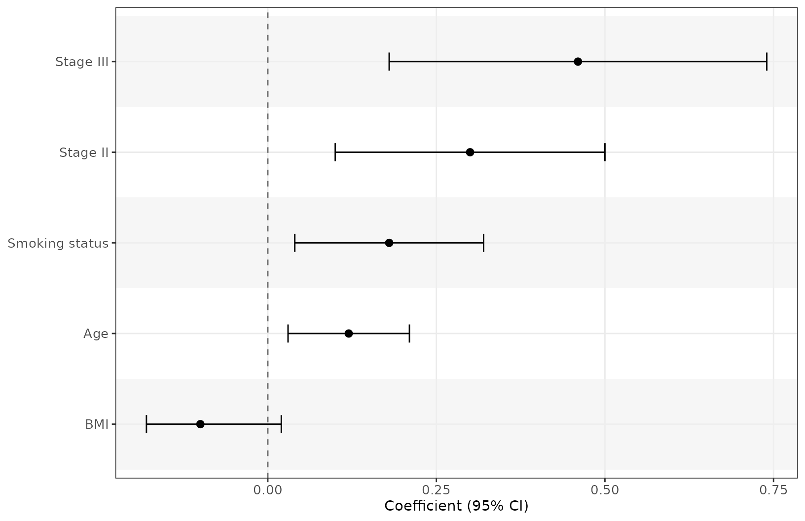

For hierarchical subgroups and reference rows, see [Preparing Forest
Data](https://thatoneguy006.github.io/ggforestplotR/dev/articles/ggforestplotR-data-helpers.md).

## Coordinate plot and table typography

Add
[`forest_theme()`](https://thatoneguy006.github.io/ggforestplotR/dev/reference/forest_theme.md)
before a table helper to set plot typography and shared table text
defaults. Use ordinary
[`theme()`](https://ggplot2.tidyverse.org/reference/theme.html) settings
after
[`forest_theme()`](https://thatoneguy006.github.io/ggforestplotR/dev/reference/forest_theme.md)
for further plot adjustments, or pass named theme settings to
[`forest_theme()`](https://thatoneguy006.github.io/ggforestplotR/dev/reference/forest_theme.md).

The table helpers also accept these controls directly, without a forest
theme:

| Target | Size | Face | Family | Colour |
|:---|:---|:---|:---|:---|
| Body rows | `text_size` | `text_fontface` | `text_family` | `text_colour` |
| Column headers | `header_text_size` | `header_fontface` | `header_family` | `header_colour` |
| Reference rows | `reference_text_size` | `reference_fontface` | `reference_family` | `reference_colour` |
| Section/subgroup headers | `row_header_text_size` | `row_header_fontface` | `row_header_family` | `row_header_colour` |

Body, reference, and row-header sizes use **millimeters**. Column-header
sizes and `forest_theme(base_size = ...)` use **points**. Font faces
accept `"plain"`, `"bold"`, `"italic"`, and `"bold.italic"`.

Explicit non-NULL table arguments override theme settings. Unspecified
reference and row-header properties inherit the resolved body style;
column headers inherit body family and colour but retain their own size
and face. Styling a reference row affects all its cells, including the
term label and reference text. Row-header styling applies to explicit
`"header"` rows and generated subgroup headers. Summary rows use the
body style.

``` r

styled_data <- data.frame(
  term = c("Treatment", "Control", "Active", "Age"),
  estimate = c(NA, NA, 1.35, 1.02),
  conf.low = c(NA, NA, 1.10, 1.01),
  conf.high = c(NA, NA, 1.66, 1.03),
  row_type = c("header", "reference", "estimate", "estimate")
)

styled_plot <- ggforestplot(
  styled_data, row_type = "row_type", exponentiate = TRUE,
  striped_rows = TRUE
) +
  forest_theme(
    base_family = "serif",
    text_size = 3.5,
    row_header_fontface = "bold",
    reference_fontface = "italic",
    reference_colour = "grey40"
  )

styled_plot +
  add_split_table(
    left_columns = "term",
    right_columns = c("estimate", "ci"),
    header_colour = "navy",
    header_text_size = 12,
    reference_text = "Ref."
  )
```

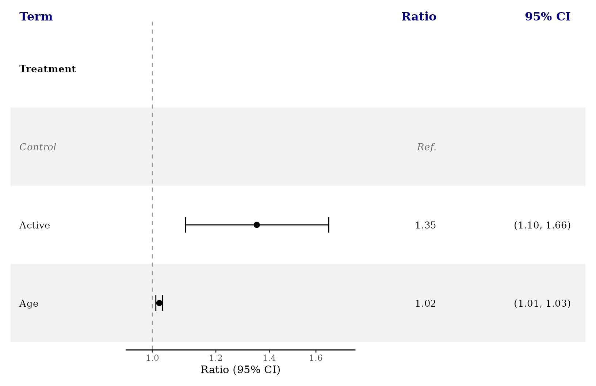

The same controls work with a side table, including direct function
syntax:

``` r

add_forest_table(
  styled_plot,
  columns = c("term", "estimate"),
  text_family = "sans",
  text_fontface = "plain",
  header_fontface = "bold.italic",
  reference_fontface = "bold",
  row_header_colour = "navy"
)
```

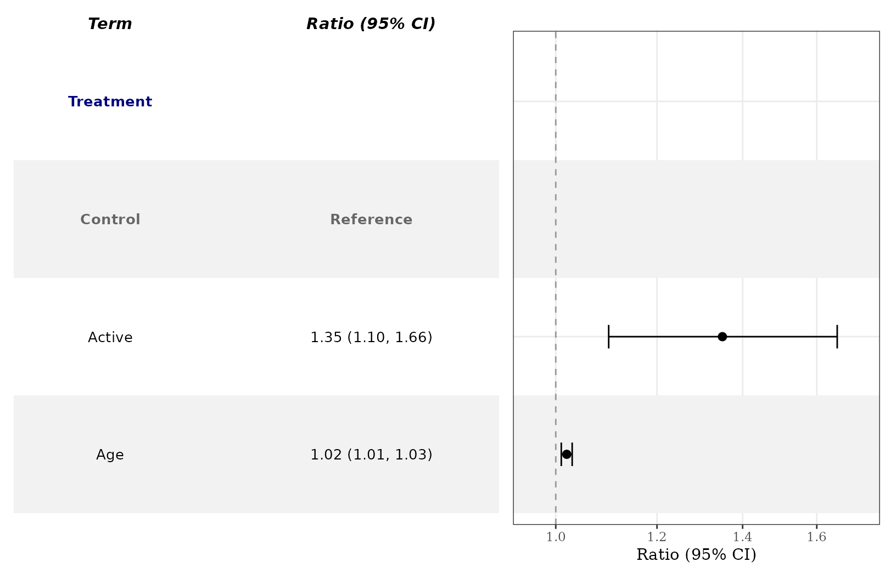

Text widths are measured using the chosen size, face, and family. Font
availability depends on your graphics device; use an installed font or a
generic family such as `"sans"`, `"serif"`, or `"mono"`. Larger text may
also need a taller export to avoid crowding rows. Apply
[`forest_theme()`](https://thatoneguy006.github.io/ggforestplotR/dev/reference/forest_theme.md)
before tables and favors; it is a forest-plot add-on, not a
[`theme_set()`](https://ggplot2.tidyverse.org/reference/get_theme.html)
replacement.

## Distinct variable separation

Use `separate_groups` and `separate_lines` when you want a more distinct
visual separation between variables. This is especially useful for
categorical variables with many levels. `separate_groups` automatically
appends the variable name to the level.

Use `separate_groups` and `separate_lines` when you want a more distinct
visual separation between variables. This is especially useful for
categorical variables with many levels. `separate_groups` automatically
appends the variable name to the level.

``` r

block_coefs <- data.frame(
  term = c("race_black", "race_white", "race_other", "age", "bmi"),
  label = c("Black", "White", "Other", "Age", "BMI"),
  estimate = c(0.24, 0.08, -0.04, 0.12, -0.09),
  conf.low = c(0.10, -0.04, -0.18, 0.03, -0.17),
  conf.high = c(0.38, 0.20, 0.10, 0.21, -0.01),
  variable_block = c("Race", "Race", "Race", "Age", "BMI")
)

ggforestplot(
  block_coefs,
  label = "label",
  separate_groups = "variable_block",
  separate_lines = TRUE,
  striped_rows = TRUE
)
```

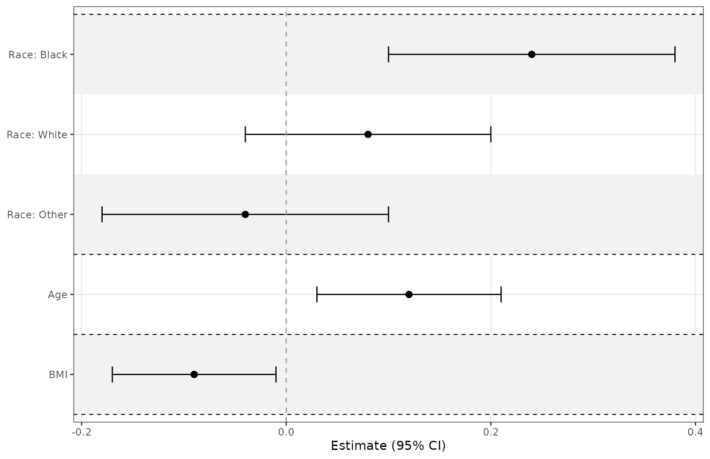

## Add a side table

[`add_forest_table()`](https://thatoneguy006.github.io/ggforestplotR/dev/reference/add_forest_table.md)
allows you to attach model information to the coefficient plot. The
table can be added to either the left or right side and allows for some
customization. Apply plot scales, labels, and themes before adding a
table. Table helpers return a patchwork composition. Add
[`add_favors()`](https://thatoneguy006.github.io/ggforestplotR/dev/reference/add_favors.md)
after the table when you want a directional footer.

You can choose which columns from your dataframe to include in the table
using the `columns` argument, and can change the labels using
`column_labels`. If some of the term labels need to be changed, use
`term_labels` to assign them new values. Some of the column labels are
automatically assigned if no value is provided.

Map source p-values explicitly with `p.value = "p_value"`. Table
selectors `"p"` and `"p.value"` refer to the canonical statistic; the
mapped source name is also accepted. Mapping selects the data; table
selectors control what is displayed.

``` r

ggforestplot(
  coefs,
  facet = "section",
  facet_strip_position = "right",
  p.value = "p_value",
  striped_rows = TRUE,
  term_labels = c("Smoking" = "Smoking status")
) +
  add_forest_table(
    columns = c("term", "sample_size", "estimate", "p_value"),
    column_labels = c("term" = "Variable", "sample_size" = "N",
                      "estimate" = "Beta (95% CI)", "p_value" = "P-value")
  )
```

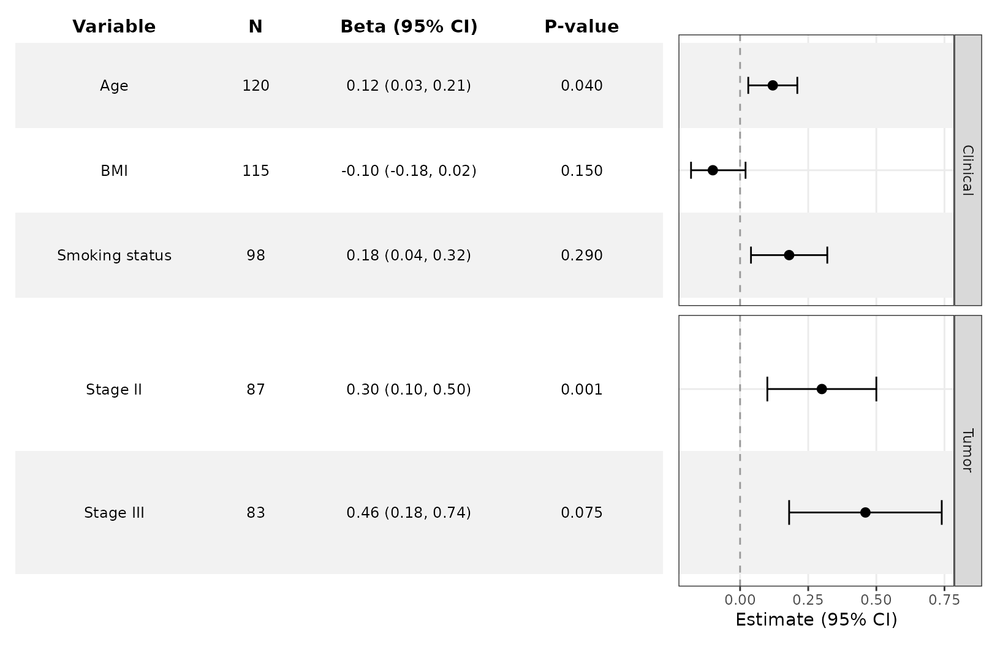

## Customize the table

`add_forest_table` also lets you change some minor styling elements of
the forest table.

``` r

ggforestplot(
  coefs,
  n = "sample_size",
  p.value = "p_value",
  striped_rows = TRUE
) +
  add_forest_table(
    position = "left",
    grid_lines = TRUE,
    grid_line_linetype = 2,
    grid_line_colour = "red"
  )
```

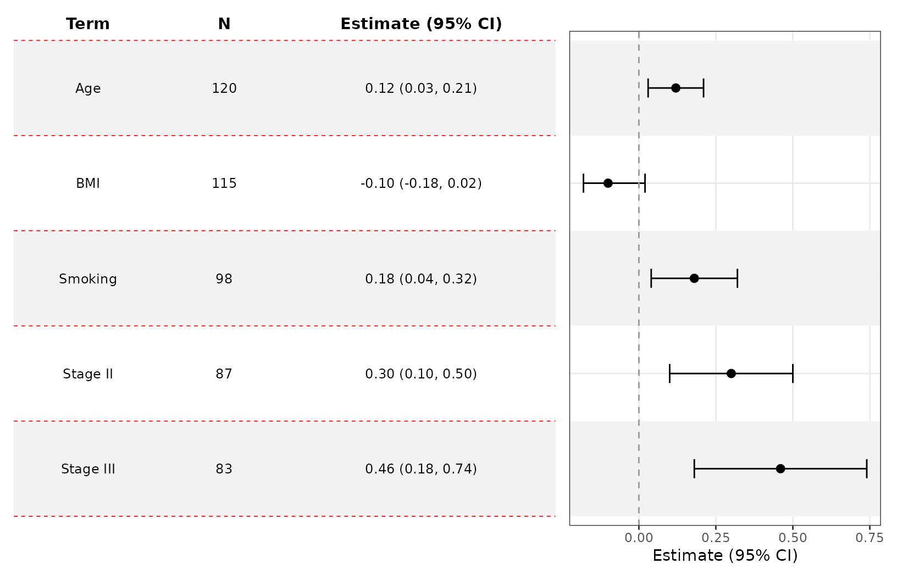

## Split tables

[`add_split_table()`](https://thatoneguy006.github.io/ggforestplotR/dev/reference/add_split_table.md)
can be used to create more traditional looking forest plots. You can
choose which summary information goes to which side. Like
[`add_forest_table()`](https://thatoneguy006.github.io/ggforestplotR/dev/reference/add_forest_table.md),
it should be added after any plot-level styling.

Use the `estimate_fmt` argument to change how your estimates are
displayed. You can also control digits via `estimate_digits`,
`interval_digits`, and `p_digits`.

``` r

ggforestplot(
  coefs,
  n = "sample_size",
  p.value = "p_value",
  striped_rows = TRUE
) +
  scale_x_continuous(limits = c(-.8,.8)) +
  add_split_table(
    left_columns = c("term","n"),
    right_columns = c("estimate","p"),
    column_labels = c("estimate" = "Beta [95% CI]"),
    estimate_fmt = "{estimate} [{conf.low}, {conf.high}]",
    estimate_digits = 2,
    interval_digits = 3,
    p_digits = 2
  )
```

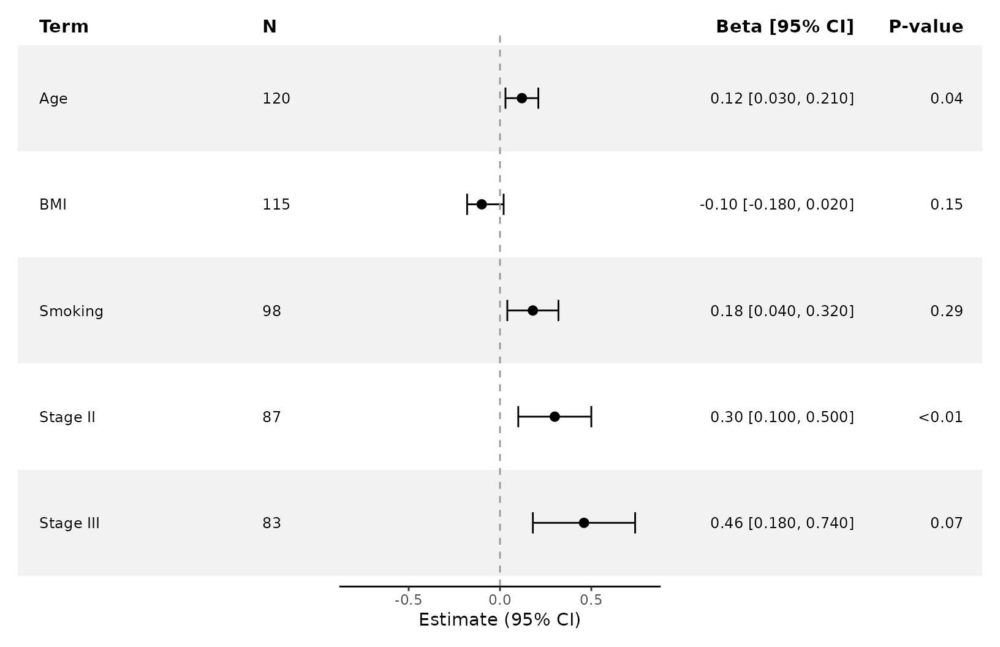

## Formatting table values with functions

`formatters` accepts a named list of vectorized functions. Each function
receives a source vector and returns one value per input. You can format
built in statistics and any preserved source column. A `ci` formatter
applies to both confidence bounds unless `conf.low` or `conf.high`
overrides it.

``` r

format_data <- data.frame(
  term = c("Age", "BMI"),
  estimate = c(0.31, -0.24),
  conf.low = c(0.12, -0.40),
  conf.high = c(0.56, -0.08),
  p.value = c(0.0004, 0.023),
  prevalence = c(0.1543, 0.2871)
)

ggforestplot(format_data, p.value = "p.value", staple_width = 0.1) +
  add_split_table(
    left_columns = c("term", "prevalence"),
    right_columns = c("estimate", "p"),
    formatters = list(
      estimate = function(x) sprintf("%.1f", x),
      ci = function(x) sprintf("%.3f", x),
      p = function(x) ifelse(x < 0.001, "<0.001", sprintf("%.3f", x)),
      prevalence = function(x) sprintf("%.1f%%", 100 * x)
    ),
    estimate_fmt = "{estimate} [{conf.low}, {conf.high}]"
  )
```

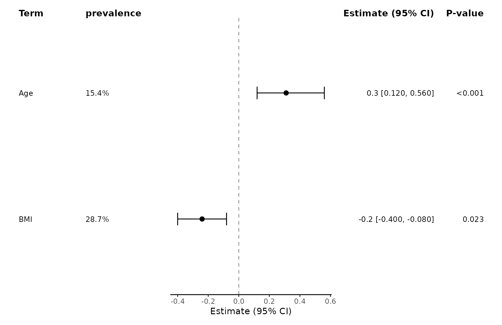

Formatter functions act on scalar source values before `estimate_fmt`
and `ci_fmt` compose text, and before grouped cells are combined.
Functions from other packages work when they follow the same vector
input and output contract.

## Compare multiple estimates

The `group` argument is handy when comparing estimates from several
models.

``` r

comparison_coefs <- data.frame(
  term = rep(c("Age", "BMI", "Smoking", "Stage II", "Stage III"), 2),
  estimate = c(0.12, -0.10, 0.18, 0.30, 0.46, 0.08, -0.05, 0.24, 0.40, 0.58),
  conf.low = c(0.03, -0.18, 0.04, 0.10, 0.18, 0.00, -0.13, 0.10, 0.20, 0.30),
  conf.high = c(0.21, -0.02, 0.32, 0.50, 0.74, 0.16, 0.03, 0.38, 0.60, 0.86),
  model = rep(c("A", "B"), each = 5)
)

ggforestplot(
  comparison_coefs,
  group = "model",
  striped_rows = TRUE,
  dodge_width = 0.5
) +
  theme(legend.position = "top") +
  scale_color_manual(values = c("#1F968BFF", "#453781FF")) +
  labs(color = "Model") +
  add_forest_table(
    column_labels = c("term" = "Term",
                      "model" = "Model",
                      "estimate"  = "Estimate (95% CI)")
    )
#> Scale for colour is already present.
#> Adding another scale for colour, which will replace the existing scale.
```

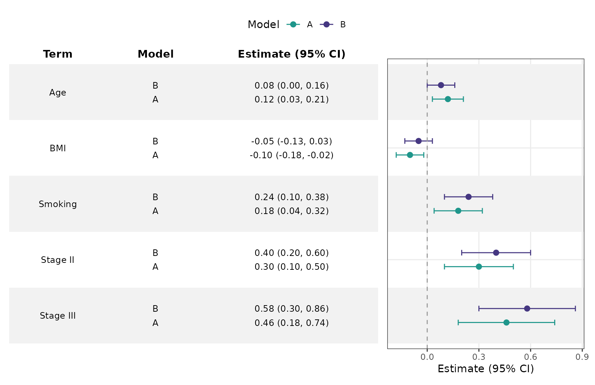

For comparing fitted models, see [Working with Fitted
Models](https://thatoneguy006.github.io/ggforestplotR/dev/articles/ggforestplotR-fitted-models.html#compare-fitted-models).

## Marker sizes and confidence intervals

Map `point_size` to a numeric source column.

``` r

ggforestplot(coefs, point_size = "sample_size", point_shape = 15) +
  scale_size_area(max_size = 5) +
  labs(size = "Sample size")
```

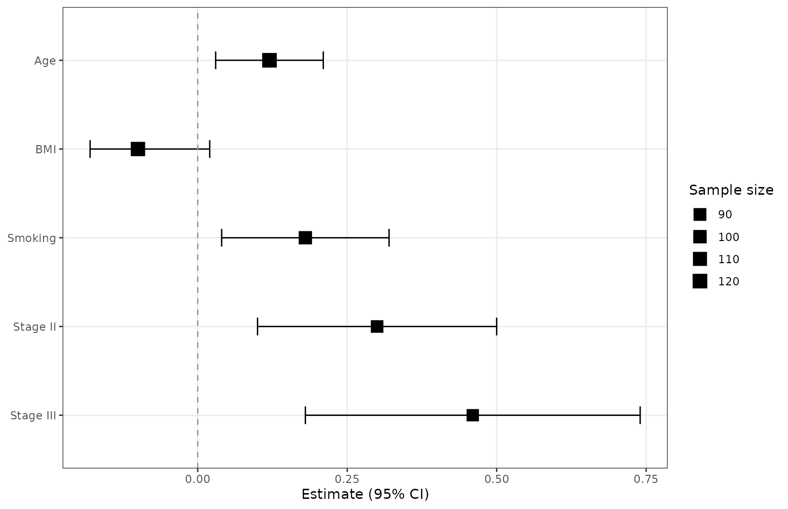

Use `ci_limits` to truncate displayed intervals with outward arrows. The
underlying estimates and table values retain their original values.

``` r

ggforestplot(coefs, ci_limits = c(-0.2, 0.6), ci_arrows = TRUE,
             striped_rows = TRUE) +
  add_forest_table(columns = c("term", "estimate"))
```

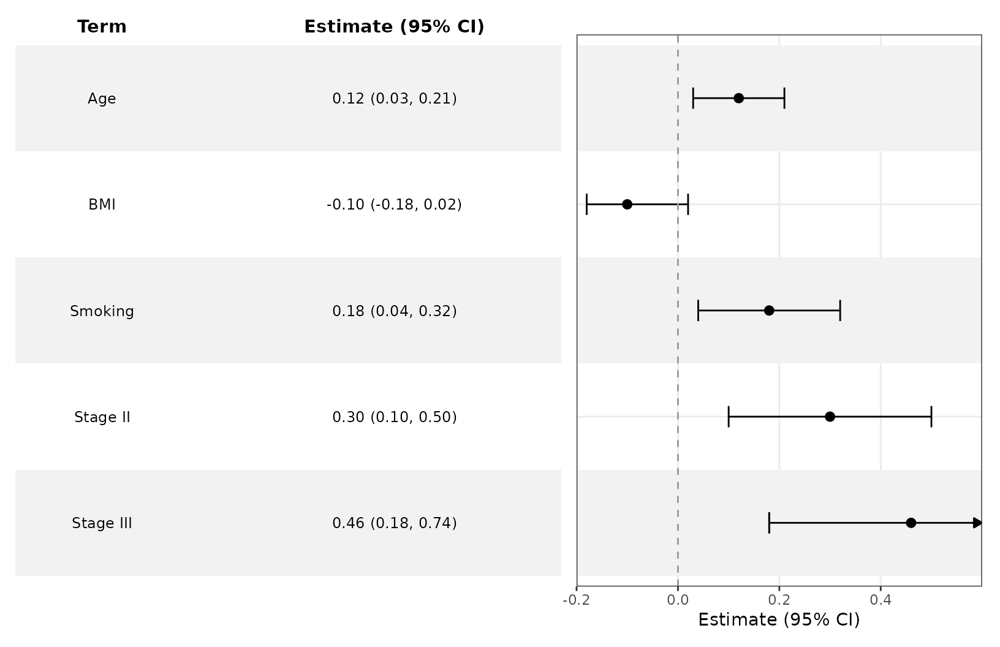

## Panel widths and directional labels

Set relative panel widths to reserve room for labels and numeric
columns. Side tables use `table_width` and `plot_width`; split tables
use `left_width`, `plot_width`, and `right_width`.

``` r

publication_plot <- ggforestplot(
  coefs, p.value = "p_value", striped_rows = TRUE
) +
  theme(axis.title.y = element_blank()) +
  add_split_table(
    left_columns = "term",
    right_columns = c("estimate", "p"),
    left_width = 1,
    plot_width = 4,
    right_width = 2
  ) +
  add_favors(left = "Lower outcome", right = "Higher outcome")

publication_plot
```

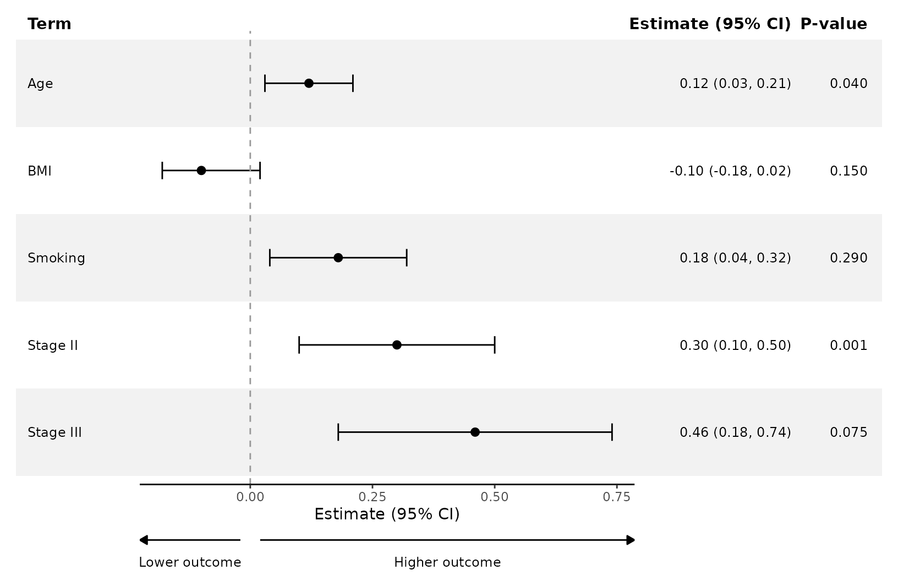

The footer uses the plot’s reference value. Choose labels appropriate to
the outcome and contrast; lower values do not always mean benefit.

## Save the complete figure

Pass the composed object to
[`ggsave()`](https://ggplot2.tidyverse.org/reference/ggsave.html).

``` r

ggsave("forest-plot.pdf", publication_plot, width = 10, height = 6)
ggsave(
  "forest-plot.png", publication_plot,
  width = 10, height = 6, dpi = 300, bg = "white"
)
```
